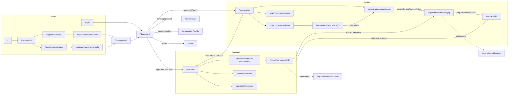

# ECOVIA routes

> Generated by `node scripts/route-docs.mjs` from [`routes.json`](routes.json) — do not edit by hand.
> The same data powers the interactive map: [`route-map.html`](route-map.html) (open it in a browser).
> `node scripts/route-docs.mjs --check` fails when a page, Route Handler or Server Action is added/removed without updating the docs.

**Access classes.** *Public*: no login. *Signed in*: any authenticated account. *Role · pending OK*: the
caller must own a profile of that role but may be pending/rejected (own CV / facility profile only).
*Approved only*: the profile must be `status = 'approved'` — pages redirect unapproved users to their own
CV (`/specialist/cv`) or facility profile (`/organization/profile`); APIs answer **401** without a session and
**403** for unapproved or role-less accounts. Records outside the caller's scope answer **404**. Rules live in
`src/lib/auth/access.ts`, `policies.ts` and `recordAccess.ts`. There is no `/waiting` route.

Server Actions are not URLs: they are POSTed by forms on the page listed under *Used on*.

## Overview

## Key flows

- **Sign-up (pending) → own CV:** `/choose-role` → `/register/specialist` → `/register/specialist/verify` → `/set-password` → `/dashboard` → `/specialist/cv` — Pending accounts never see a waiting page; approved-only pages redirect back to /specialist/cv.
- **Facility sign-up (pending) → own profile:** `/register/organization` → `/register/organization/verify` → `/set-password` → `/dashboard` → `/organization/profile`
- **Login:** `/login` → `/dashboard` → `/specialist` — /dashboard decides: workspace if approved, own CV/profile if pending, /choose-role without a profile.
- **Request → offers → contract:** `/organization/requests/new` → `createServiceRequestAction` → `/organization/requests/[id]` → `/specialist/notifications` → `/specialist/requests` → `/specialist/requests/[id]` → `submitOfferAction` → `prepareContractAction` → `/contracts/[id]` → `signContractAction` → `/specialist/services` — The request stays open for offers until signContractAction; at most one signed contract per request (DB unique index).
- **Private request:** `/organization/specialists` → `/organization/specialists/[id]` → `/organization/requests/new` → `/specialist/requests/[id]` — ?specialist=<id>; only that specialist can see it (others: 404).
- **Chat & documents:** `/organization/requests/[id]` → `/organization/messages` → `/api/directory` → `/organization/specialists/[id]` → `/api/files/[id]` → `/contracts/[id]`
- **Account switch (dual profile):** `/specialist` → `switchAccountAction` → `/organization`
- **Add a second profile to the same login:** `/specialist/cv` → `/register/organization` → `/register/organization/verify` → `/dashboard` → `/organization/profile` — Signed-in user, no OTP; the new profile is pending until approved; the switcher then lists it as pending.
- **Rejected account re-review:** `/admin` → `/api/admin/accounts/reject` → `/specialist/cv` → `resubmitForReviewAction` → `/api/admin/accounts/[kind]/[id]` → `/api/admin/accounts/approve` — rejected → pending (owner resubmits or admin reopens via /api/admin/accounts/reopen) → approved/rejected; every step is in the review history.

## Inventory

### Public

| Path | Type | Access | Roles | Params | Redirects | Purpose | File |
|---|---|---|---|---|---|---|---|
| `/` | page | Public | anyone |  |  | Public landing page (Server Component with small interactive islands). | `src/app/page.tsx` |
| `/choose-role` | page | Public | anyone |  |  | Choose account type before registration. | `src/app/choose-role/page.tsx` |

### Authentication

| Path | Type | Access | Roles | Params | Redirects | Purpose | File |
|---|---|---|---|---|---|---|---|
| `/login` | page | Public | anyone | next; returnTo; callbackUrl; redirect; redirectUrl (same-origin paths only) | signed in → next \|\| /dashboard | Email/phone + password sign-in. Signed-in visitors are redirected to ?next or /dashboard. | `src/app/login/page.tsx` |
| `/register/specialist` | page | Public | anyone |  | → /register/specialist/verify | Specialist registration form (OCR-assisted). Signed-in users without a specialist profile see a "linking" notice: the profile is added to their existing login (pending). Users who already own one are redirected to it. | `src/app/register/specialist/page.tsx` |
| `/register/specialist/step-1` | redirect | Public | anyone |  | → /register/specialist | Legacy step URL. | `src/app/register/specialist/step-1/page.tsx` |
| `/register/specialist/step-2` | redirect | Public | anyone |  | → /register/specialist | Legacy step URL. | `src/app/register/specialist/step-2/page.tsx` |
| `/register/specialist/verify` | page | Public | anyone |  | → /set-password?next=/dashboard, or (signed in) → /dashboard → own new profile | New visitors: phone OTP → session → PENDING specialist profile. Signed-in users: confirmation step (no OTP) that attaches the pending profile to the same login. | `src/app/register/specialist/verify/page.tsx` |
| `/register/organization` | page | Public | anyone |  | → /register/organization/verify | Facility registration form (CR lookup). Signed-in users without a facility profile add it to their existing login (pending); existing owners are redirected. | `src/app/register/organization/page.tsx` |
| `/register/organization/verify` | page | Public | anyone |  | → /set-password?next=/dashboard | New visitors: email OTP → session → PENDING facility profile. Signed-in users: confirmation step attaching the pending profile to the same login. | `src/app/register/organization/verify/page.tsx` |
| `/set-password` | page | Public | anyone | next (same-origin only; default /dashboard) | → next | Password setup after OTP sign-up (POSTs /api/account/password, which requires the session). | `src/app/set-password/page.tsx` |
| `/forgot-password` | page | Public | anyone |  |  | Password reset by phone/email OTP (server page; client form). | `src/app/forgot-password/page.tsx` |

### Pending CV

| Path | Type | Access | Roles | Params | Redirects | Purpose | File |
|---|---|---|---|---|---|---|---|
| `/specialist/cv` | page | Role · pending OK | specialist |  |  | Own CV editor (+ work region), print, registration details and attachments. Landing page for pending/rejected specialists with the approval banner. | `src/app/specialist/cv/page.tsx` |
| `/organization/profile` | page | Role · pending OK | facility |  |  | Facility profile: logo, fields of business, description, website, phone; registration details and CR attachment. Landing page for pending facilities. | `src/app/organization/profile/page.tsx` |

### Shared

| Path | Type | Access | Roles | Params | Redirects | Purpose | File |
|---|---|---|---|---|---|---|---|
| `/dashboard` | page | Signed in | specialist, facility, admin |  | → /specialist \| /specialist/cv \| /organization \| /organization/profile \| /choose-role \| /admin | Server-side entry point: approved → workspace; pending/rejected → own CV / facility profile; no profile → /choose-role; admin → /admin. Never /waiting. | `src/app/dashboard/page.tsx` |
| `/contracts/[id]` | page | Approved only | specialist, facility, admin | id (contract uuid); notice | unapproved → own CV/profile; unrelated → 404 | Contract document for its two parties (or admin). Drafts are labelled as drafts; signing (specialist) and withdrawal (facility) of pending contracts. Printable. Others get 404. | `src/app/contracts/[id]/page.tsx` |

### Specialist

| Path | Type | Access | Roles | Params | Redirects | Purpose | File |
|---|---|---|---|---|---|---|---|
| `/specialist` | page | Approved only | specialist |  | pending → /specialist/cv | Specialist home: live counters (available/private requests, active offers, contracts to sign, ongoing services, unread notifications). | `src/app/specialist/page.tsx` |
| `/specialist/requests` | page | Approved only | specialist | tab=open\|offers\|contracted\|declined; region=<region code>; page | pending → /specialist/cv | Request discovery: open public requests (region filter) + private requests addressed to me; tabs for my offers, contracts, declined. | `src/app/specialist/requests/page.tsx` |
| `/specialist/requests/[id]` | page | Approved only | specialist | id; notice | pending → /specialist/cv | Request detail per visibility rules (private: target only, else 404): facility card (+CR after relationship), offer form (duration), withdraw/decline, contract signing, progress steps, chat link. | `src/app/specialist/requests/[id]/page.tsx` |
| `/specialist/services` | page | Approved only | specialist | page | pending → /specialist/cv | Requests contracted to me (signed contracts): ongoing and completed. | `src/app/specialist/services/page.tsx` |
| `/specialist/messages` | page | Approved only | specialist | chat=chat_<orgUserId>_<specUserId> | pending → /specialist/cv | Chat with facilities (client island polling /api/chat/*); contract cards link to /contracts/[id]. | `src/app/specialist/messages/page.tsx` |
| `/specialist/notifications` | page | Approved only | specialist | page | pending → /specialist/cv | The user's own notifications; open / mark read / mark all read (Server Actions). | `src/app/specialist/notifications/page.tsx` |
| `/specialist/organizations` | redirect | Signed in | specialist |  | → /specialist | Legacy URL (removed "apply to organizations"). | `src/app/specialist/organizations/page.tsx` |
| `/specialist/projects` | redirect | Signed in | specialist |  | → /specialist/services | Legacy URL. | `src/app/specialist/projects/page.tsx` |
| `/specialist/projects/[id]` | redirect | Signed in | specialist |  | → /specialist/services | Legacy URL. | `src/app/specialist/projects/[id]/page.tsx` |

### Facility/Organization

| Path | Type | Access | Roles | Params | Redirects | Purpose | File |
|---|---|---|---|---|---|---|---|
| `/organization` | page | Approved only | facility |  | pending → /organization/profile | Facility home: live counters (open requests, offers to review, contracts awaiting signature, ongoing, unread notifications) and open requests. | `src/app/organization/page.tsx` |
| `/organization/requests` | page | Approved only | facility | tab=open\|contracted\|previous; page | pending → /organization/profile | Own requests with offer counts. | `src/app/organization/requests/page.tsx` |
| `/organization/requests/new` | page | Approved only | facility | specialist=<specialist uuid> (private request) | → /organization/requests/[id]?created=1 | Submit New Service Request: Service Type multi-select (4 services), Activity Description, Notes, region, city. No price, no duration. ?specialist= makes it private. | `src/app/organization/requests/new/page.tsx` |
| `/organization/requests/[id]` | page | Approved only | facility | id; created; notice | foreign id → 404 | Own request detail: compare offers, decline, select & prepare contract (request stays open), withdraw contract, cancel request, chat links, view contract. | `src/app/organization/requests/[id]/page.tsx` |
| `/organization/specialists` | page | Approved only | facility | q; region=<region code>; years=0-2\|3-5\|6-10\|11+; city; page |  | Competency directory of approved specialists, filtered on the server from URL params (search, region, experience, city, page); contact, profile, private request. | `src/app/organization/specialists/page.tsx` |
| `/organization/specialists/[id]` | page | Approved only | facility | id (specialist uuid) |  | Specialist profile + current CV (national ID masked), print, contact, private request; permit file only after a business relationship. | `src/app/organization/specialists/[id]/page.tsx` |
| `/organization/messages` | page | Approved only | facility | chat | pending → /organization/profile | Chat with specialists; View CV (by specialist profile id) and full profile link. | `src/app/organization/messages/page.tsx` |
| `/organization/notifications` | page | Approved only | facility | page | pending → /organization/profile | The user's own notifications. | `src/app/organization/notifications/page.tsx` |

### Admin/Review

| Path | Type | Access | Roles | Params | Redirects | Purpose | File |
|---|---|---|---|---|---|---|---|
| `/admin` | page | Public | admin |  |  | Admin portal (server page + lazily loaded client dashboard): approve/reject pending accounts, reopen rejected ones, account details with attachments and review history. Admin APIs re-check role=admin. | `src/app/admin/page.tsx` |

### API

| Path | Type | Access | Roles | Params | Redirects | Purpose | File |
|---|---|---|---|---|---|---|---|
| `/api/auth/[...all]` | api (GET, POST) | Public | anyone |  |  | Better Auth handler (sessions, sign-in endpoints). Public email/password sign-up is disabled — accounts come only from the OTP registration flow. | `src/app/api/auth/[...all]/route.ts` |
| `/api/login` | api (POST) | Public | anyone |  |  | Email or phone + password sign-in; failed attempts are throttled per identity and IP (429). | `src/app/api/login/route.ts` |
| `/api/session` | api (GET) | Public | anyone |  |  | Who is signed in: user, own profiles, active context, entryPath. | `src/app/api/session/route.ts` |
| `/api/session/logout` | api (POST) | Public | anyone |  |  | Revokes the session (any account state) and clears cookies. | `src/app/api/session/logout/route.ts` |
| `/api/session/otp` | api (POST) | Public | anyone |  |  | Request an email OTP (rate-limited; demo mode by allowlist). | `src/app/api/session/otp/route.ts` |
| `/api/session/verify` | api (POST) | Public | anyone |  |  | Verify email OTP and create the session. | `src/app/api/session/verify/route.ts` |
| `/api/session/phone-otp` | api (POST) | Public | anyone |  |  | Request a phone OTP (rate-limited). | `src/app/api/session/phone-otp/route.ts` |
| `/api/session/phone-verify` | api (POST) | Public | anyone |  |  | Verify phone OTP and create the session. | `src/app/api/session/phone-verify/route.ts` |
| `/api/password/forgot/request` | api (POST) | Public | anyone |  |  | Start password reset. | `src/app/api/password/forgot/request/route.ts` |
| `/api/password/forgot/reset` | api (POST) | Public | anyone |  |  | Finish password reset. | `src/app/api/password/forgot/reset/route.ts` |
| `/api/account/password` | api (POST) | Signed in | anyone |  |  | Set the first password for the session user. | `src/app/api/account/password/route.ts` |
| `/api/account/password-status` | api (GET) | Signed in | anyone |  |  | Whether the session user has a password. | `src/app/api/account/password-status/route.ts` |
| `/api/register/specialist` | api (POST) | Signed in | anyone |  |  | Create the PENDING specialist profile for the session user (attached permit must be own upload). | `src/app/api/register/specialist/route.ts` |
| `/api/register/organization` | api (POST) | Signed in | anyone |  |  | Create the PENDING facility profile for the session user (attached CR must be own upload). | `src/app/api/register/organization/route.ts` |
| `/api/specialist/profile` | api (GET, PATCH) | Role · pending OK | specialist |  |  | Own CV read/update (pending allowed; attached files must be own uploads of the right kind). | `src/app/api/specialist/profile/route.ts` |
| `/api/organization/profile` | api (GET, PATCH) | Role · pending OK | facility |  |  | Own facility profile read/update (pending allowed; name/CR not editable). | `src/app/api/organization/profile/route.ts` |
| `/api/files` | api (POST) | Signed in | anyone |  |  | Upload a document (magic-byte type check, 4 MB, 30 uploads/15 min/user). | `src/app/api/files/route.ts` |
| `/api/files/[id]` | api (GET) | Signed in | anyone | id |  | Stream a private file after the document policy (owner, admin, or workflow counterparty). 401/403/404. | `src/app/api/files/[id]/route.ts` |
| `/api/service-requests` | api (GET, POST) | Approved only | specialist, facility | as=org\|spec; tab; region; page |  | GET: caller-scoped request lists (?as, ?tab, ?region, ?page). POST: approved facility publishes (service types, activity description, notes, region) — no price/duration. | `src/app/api/service-requests/route.ts` |
| `/api/service-requests/[id]` | api (GET) | Approved only | specialist, facility | id |  | One request if visible to the caller (private: target only). 403 unapproved, 404 invisible. | `src/app/api/service-requests/[id]/route.ts` |
| `/api/directory` | api (GET) | Approved only | specialist, facility, admin | kind=specialists\|organizations; id |  | Approved organizations → specialists (and one CV by profile id); approved specialists → organizations. 403 for pending. | `src/app/api/directory/route.ts` |
| `/api/chat/conversations` | api (GET) | Approved only | specialist, facility |  |  | Own conversations (approved profiles only). | `src/app/api/chat/conversations/route.ts` |
| `/api/chat/messages` | api (GET, POST) | Approved only | specialist, facility | chatId |  | Read / send plain messages as a participant (2000 chars, 30/min). Contract creation from chat was removed. | `src/app/api/chat/messages/route.ts` |
| `/api/chat/contracts/sign` | api (POST) | Approved only | specialist |  |  | Sign a contract from its chat card (same atomic path as the request page). | `src/app/api/chat/contracts/sign/route.ts` |
| `/api/notifications/unread-count` | api (GET) | Approved only | specialist, facility |  |  | Session user's unread count (bell polling). | `src/app/api/notifications/unread-count/route.ts` |
| `/api/admin/login` | api (POST) | Public | admin |  |  | Admin email/password sign-in (role checked server-side; failed attempts throttled). | `src/app/api/admin/login/route.ts` |
| `/api/admin/logout` | api (POST) | Public | admin |  |  | Admin sign-out. | `src/app/api/admin/logout/route.ts` |
| `/api/admin/session` | api (GET) | Public | admin |  |  | Whether the caller is an admin. | `src/app/api/admin/session/route.ts` |
| `/api/admin/accounts` | api (GET) | Admin | admin |  |  | All specialist/facility accounts for review. | `src/app/api/admin/accounts/route.ts` |
| `/api/admin/accounts/approve` | api (POST) | Admin | admin |  |  | Approve a PENDING account (audited); rejected accounts must be reopened/resubmitted first (409). | `src/app/api/admin/accounts/approve/route.ts` |
| `/api/admin/accounts/reject` | api (POST) | Admin | admin |  |  | Reject a PENDING account with a reason (audited). | `src/app/api/admin/accounts/reject/route.ts` |
| `/api/admin/accounts/reopen` | api (POST) | Admin | admin |  |  | Reopen a REJECTED account for review (rejected → pending, audited; grants nothing). | `src/app/api/admin/accounts/reopen/route.ts` |
| `/api/admin/accounts/[kind]/[id]` | api (GET) | Admin | admin | kind=specialists\|organizations; id |  | Full registration record, attachment metadata and review history (registered / rejected / resubmitted / reopened / approved) of one account. | `src/app/api/admin/accounts/[kind]/[id]/route.ts` |

### Server Actions

| Server Action | Access | Roles | Used on | Purpose | File |
|---|---|---|---|---|---|
| `switchAccountAction` | Signed in | specialist, facility | AppShell | Switch the active context to another OWNED profile (cookie; never grants a role). | `src/server/actions/account.ts` |
| `logoutAction` | Signed in | anyone | AppShell | Revoke the session and clear cookies (works for pending users). | `src/server/actions/account.ts` |
| `updateOrganizationProfileAction` | Role · pending OK | facility | /organization/profile | Save facility profile (logo must be own upload). | `src/server/actions/profile.ts` |
| `createServiceRequestAction` | Approved only | facility | /organization/requests/new | Publish a public/private request + notifications in one transaction. | `src/server/actions/marketplace.ts` |
| `cancelServiceRequestAction` | Approved only | facility | /organization/requests/[id] | Cancel an open request; void pending contracts; inform offerers. | `src/server/actions/marketplace.ts` |
| `declineOfferAction` | Approved only | facility | /organization/requests/[id] | Decline a submitted offer. | `src/server/actions/marketplace.ts` |
| `prepareContractAction` | Approved only | facility | /organization/requests/[id] | Select an offer and prepare its contract (request stays open). | `src/server/actions/marketplace.ts` |
| `withdrawContractAction` | Approved only | facility | /organization/requests/[id], /contracts/[id] | Withdraw a pending contract (offer returns to submitted). | `src/server/actions/marketplace.ts` |
| `submitOfferAction` | Approved only | specialist | /specialist/requests/[id] | Submit or revise an offer with execution duration. | `src/server/actions/marketplace.ts` |
| `withdrawOfferAction` | Approved only | specialist | /specialist/requests/[id] | Withdraw own offer (cancels its pending contract). | `src/server/actions/marketplace.ts` |
| `signContractAction` | Approved only | specialist | /specialist/requests/[id], /contracts/[id] | Atomically sign; closes the request; declines other offers. | `src/server/actions/marketplace.ts` |
| `declineRequestAction` | Approved only | specialist | /specialist/requests/[id] | "Not for me" (personal decline). | `src/server/actions/marketplace.ts` |
| `undoDeclineAction` | Approved only | specialist | /specialist/requests/[id] | Undo personal decline. | `src/server/actions/marketplace.ts` |
| `advanceRequestStatusAction` | Approved only | specialist | /specialist/requests/[id] | Contracted specialist: accepted → in_progress → completed. | `src/server/actions/marketplace.ts` |
| `openNotificationAction` | Approved only | specialist, facility | /*/notifications | Mark own notification read and open its record. | `src/server/actions/notifications.ts` |
| `markNotificationReadAction` | Approved only | specialist, facility | /*/notifications | Mark own notification read. | `src/server/actions/notifications.ts` |
| `markAllNotificationsReadAction` | Approved only | specialist, facility | /*/notifications | Mark all own notifications read. | `src/server/actions/notifications.ts` |
| `resubmitForReviewAction` | Role · pending OK | specialist, facility | Approval banner on /specialist/cv and /organization/profile | A REJECTED owner resubmits for review after corrections (rejected → pending, audited; stays unapproved). | `src/server/actions/profile.ts` |
